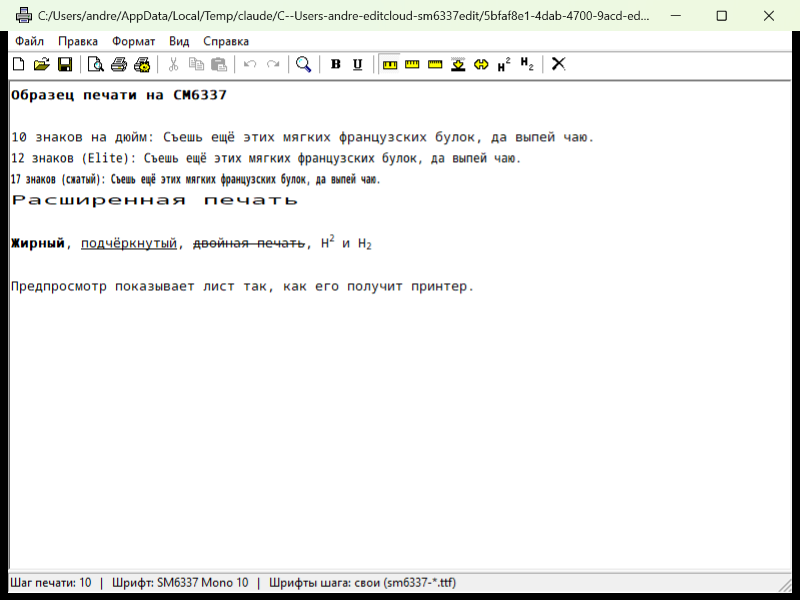

# SM6337 Edit

[English](README.en.md) | **Русский**

WordPad-подобный текстовый редактор для настоящей **Windows 98 SE**, с прямой
печатью на советский матричный принтер **СМ6337** (Epson ESC/P-совместимый клон)
через LPT1 — **без драйвера**, сырыми ESC/P-командами.



Пишется и тестируется на реальном железе: и Win98 SE, и сам принтер — настоящие,
не эмуляция.

## Почему так

Штатный универсальный Windows-драйвер для таких принтеров печатает всё как
графику (растеризует), из-за чего мелкий текст выходит нечитаемым. SM6337 Edit
вместо этого шлёт печатному тексту нативные ESC/P-команды принтера — текст
получается чётким, как из ПЗУ-шрифта самого принтера.

## Возможности

- Редактирование как в WordPad: жирный, подчёркнутый, цвет текста (для разметки
  в самом документе — принтер монохромный)
- То, чего в обычном WordPad нет, потому что это про сам принтер:
  - двойная печать (ESC G/H), расширенная печать (ESC W)
  - шаг печати 10/12/17 cpi (Pica / Elite / Pica+Condensed) — на экране разной ширины
    при одной высоте знака (свои шрифты, встроенные в exe)
  - верхний/нижний индекс (ESC S/T)
  - кодовая таблица ПЭВМ 14 или доп. CP866-совместимая 15 (ESC R)
- Свои лимиты страницы (символов в строке, строк, левое поле, межстрочный
  интервал) — программный перенос строк в редакторе либо аппаратный (ESC Q/C)
- Альбомная ориентация (переключатель в «Настройке печати»): при включении размер страницы
  пересчитывается сам пропорционально сторонам A4 (строка длиннее, строк меньше, например
  82×70 → 116×49), обратно — так же; предпросмотр показывает лист боком
- Настройка "не слать аппаратный ПФ" — на листах A4 обычный форм-фид уводит
  принтер в АВР (сбой), поэтому по умолчанию вместо него шлётся нужное число
  пустых строк
- Однонаправленная печать (ESC U) — точнее, но медленнее
- Печать имени файла по центру первой строки листа — флажок в «Настройке печати»
- Сохранение/открытие в `.rtf` (RichEdit сам сериализует форматирование)
  и в обычный `.txt`; перед закрытием, созданием и открытием другого файла программа спрашивает
  о несохранённых изменениях (в заголовке окна звёздочка), файл можно перетащить на окно или
  открыть из командной строки; сохранение идёт через временный файл — прежний не теряется при сбое
- Все настройки живут в `C:\edit\sm6337.ini`, переживают перезапуск
- Предпросмотр печати (Файл → Предпросмотр печати, кнопка с листом и лупой): показывает
  листы так, как их получит принтер — по тому же потоку ESC/P, что уходит на LPT1
- Поиск по тексту (Ctrl+F, F3 — найти далее) и повтор действия (Ctrl+Y)
- Встроенная справка WinHelp (F1, Справка → Содержание): 13 тем — от форматирования до
  неполадок с принтером; исходники в `help/`, готовый `sm6337edit.hlp` — в `redist/`
- Тулбар: подсказки на всех кнопках при наведении, серые кнопки для
  недоступных сейчас действий, залипающие — для текущего форматирования
  выделения (жирный/подчёркнутый/шаг печати/индексы и т.д.)

## Как форматирование превращается в команды принтера

Программа не хранит «шаг печати» отдельным атрибутом — RichEdit такого не знает. Шаг определяется
по **имени шрифта** и размеру знака в каждом куске текста:

| Шрифт в тексте | Что уйдёт на принтер |
|---|---|
| `SM6337 Mono 10` или `Courier New` | 10 знаков/дюйм (Pica) |
| `SM6337 Mono 12` | 12 знаков/дюйм (Elite, ESC M) |
| `SM6337 Mono 17` | 17 знаков/дюйм (сжатый, SI) |
| `SM6337 Mono Wide` | расширенная печать (ESC W) |
| `Terminal` | 12 знаков/дюйм — **старая схема**, см. ниже |
| `Small Fonts` | 17 знаков/дюйм — **старая схема**, см. ниже |
| `Courier New` ровно 14 pt | расширенная печать — **старая схема** |
| любой другой шрифт | 10 знаков/дюйм, как Pica |

Остальное:

- жирный → ESC E, подчёркнутый → ESC -, верхний/нижний индекс → ESC S/T;
- **зачёркнутый → двойная печать** (ESC G): отдельного атрибута «двойной удар» в RichEdit нет, этот
  выбран как наименее нужный в принтерном тексте; на экране он выглядит как обычное зачёркивание;
- **цвет и размер шрифта на печать не влияют** (кроме 14 pt Courier New из старой схемы) — принтер
  монохромный, ширину знака задаёт только шаг;
- если собственных шрифтов `SM6337 Mono *` нет в системе (не удалось установить), на экране вместо них
  подставляется что-то другое, и ширина знаков на экране перестаёт совпадать с печатью; на сам поток
  ESC/P это не влияет — он берётся из имени шрифта в файле.

**Старая схема.** В первых версиях программы собственных шрифтов не было, а шаг кодировался
растровыми шрифтами Windows: `Terminal` — 12, `Small Fonts` — 17, Courier New 14 pt — расширенный.
Это оставлено ради старых `.rtf`. Побочный эффект: чужой документ со шрифтом `Terminal` или
`Small Fonts` напечатается с другим шагом, чем выглядит. Для новых документов выбирай `SM6337 Mono *`.

## Скачать

В разделе [Releases](../../releases) два варианта одной и той же программы:

- **`sm6337edit.exe`** — один файл: RichEdit, иконки, шрифты и справка встроены в него. Копируй на
  машину с Win98 SE и запускай. При запуске программа раскладывает встроенные DLL, шрифты и справку в
  `%TEMP%\SM6337Edit\` (уже лежащие не переписывает).
- **`sm6337edit-full-<версия>.zip`** — то же, но со всеми файлами рядом с exe (`riched20.dll`,
  `riched32.dll`, `toolbar.bmp`, `sm6337edit.hlp`/`.cnt`, шрифты `sm6337-*.ttf`, `OFL.txt`).
  Если рядом с exe лежит `riched20.dll`, программа берёт всё из своей папки и ничего не распаковывает
  — так можно подменить любую DLL, шрифт, иконки или справку, и ничего не пишется во временную папку.

Сообщить о проблеме можно через [Issues](../../issues/new/choose).

## Сборка

### Локально

Нужен тулчейн `i686-w64-mingw32` (msvcrt, win32-threads, НЕ UCRT) — например,
[niXman/mingw-builds-binaries](https://github.com/niXman/mingw-builds-binaries).
Распакуй в `toolchain/mingw32/`, затем:

```
make
```

Результат — один файл `build/sm6337edit.exe` (около 800 КБ): иконки, RichEdit, шрифты и справка
встраиваются в него ресурсами (`src/app.rc`), рядом ничего копировать не нужно. `make full` дополнительно
собирает папку `build-full/` — версию со всеми файлами рядом с exe.

### Через GitHub Actions

На каждый пуш в `master` и на каждый PR репозиторий сам собирает `sm6337edit.exe`
тем же тулчейном (workflow `.github/workflows/build.yml`) и кладёт его в Artifacts
соответствующего прогона на вкладке Actions — можно скачать готовый файл без
локального тулчейна.

## Структура репозитория

- `src/` — исходники (`main.c`, `printer.c`/`printer.h` — печать и кодовые таблицы,
  `preview.c`/`preview.h` — предпросмотр печати, `resource.h`)
- `help/` — исходники справки (RTF, проект и оглавление), как их скомпилировать — в `help/README.md`
- `redist/` — то, что встраивается в exe: `riched20.dll`/`riched32.dll` (RichEdit из Win98 SE),
  `icons/toolbar.bmp`, скомпилированная справка `sm6337edit.hlp` и `fonts/` — шрифты шага
  печати 10/12/17 (производные от Noto Sans Mono, лицензия OFL)
- `src/app.rc` — список встраиваемых ресурсов
- `printer_commands.md` — справочник команд ESC/P и кодовых таблиц СМ6337,
  собран вручную по руководству (`СМ6337 РЭ.djvu`)
- `rom/` — дамп символогенератора принтера

## Почему ANSI, а не Unicode

Изначально код был на `*W` (Unicode) Win32 API. На настоящей Win98 SE
выяснилось, что часть базовых `*W`-функций (`GetModuleFileNameW`,
`LoadLibraryW`, `wsprintfW`, а также некоторые поля `CHARFORMAT2` вроде
`CFM_SPACING`) либо не реализованы, либо работают не так, как задокументировано.
Переписано на классический ANSI-путь (`*A` + CP1251) — так исторически и
делались русские Win9x-программы, и это реально надёжнее на этой ОС.

## Запуск

Только на настоящей Windows 98 SE (или совместимой Win9x) — используются `*A`
(ANSI) Win32 API и прямая запись в LPT1 через `CreateFileA("LPT1", ...)`.

## Сторонние компоненты

- **`redist/riched20.dll`, `redist/riched32.dll`** — библиотеки RichEdit (Richedit 2.0, © Microsoft
  Corporation, 1997). Они **не** под лицензией MIT этого проекта и не принадлежат автору: лежат в
  репозитории и встроены в exe только потому, что программа без них не запустится на «голой»
  Windows 98 SE. Права на них — у Microsoft; если ты правообладатель и возражаешь, напиши в Issues —
  библиотеки будут убраны. Хочешь собрать без них — возьми свои копии из дистрибутива Windows 98 или
  Office и положи в `redist/`; при запуске программа сначала пробует системный `riched20.dll`.
- **`redist/fonts/*.ttf`** — производные от Noto Sans Mono, SIL OFL 1.1 (`redist/fonts/OFL.txt`).
- **`rom/`** и `СМ6337 РЭ.djvu` — дамп ПЗУ принтера и скан его руководства по эксплуатации, лежат как
  справочный материал; программа их не использует. Происхождение дампа не установлено.

Статус: **бета**. Печать проверена на реальном принтере СМ6337, но программа писалась в основном без
запуска на Windows 98 SE — возможны ошибки. Сообщения о них — в Issues.

## Об авторстве

Проект разрабатывается автором совместно с ИИ-ассистентом Claude (Anthropic):
ассистент писал и правил код, иконки, подсказки, поиск и повтор, предпросмотр
печати, сборку через GitHub Actions и документацию — под руководством автора.
Всё тестируется автором на реальном железе: Win98 SE и принтере СМ6337.
Участие ассистента отмечено в описаниях коммитов (строка `Assisted-by`).

---

<sub>В тулбаре справа есть кнопка с крестиком, не связанная ни с одной
командой редактирования — это пасхалка-розыгрыш (серия диалогов, а на
настоящей Win9x — имитация зависания системы). К функциям редактора и
печати отношения не имеет, найдена быстро, специально не документируется
подробнее из уважения к тем, кто хочет наткнуться на неё сам.</sub>
